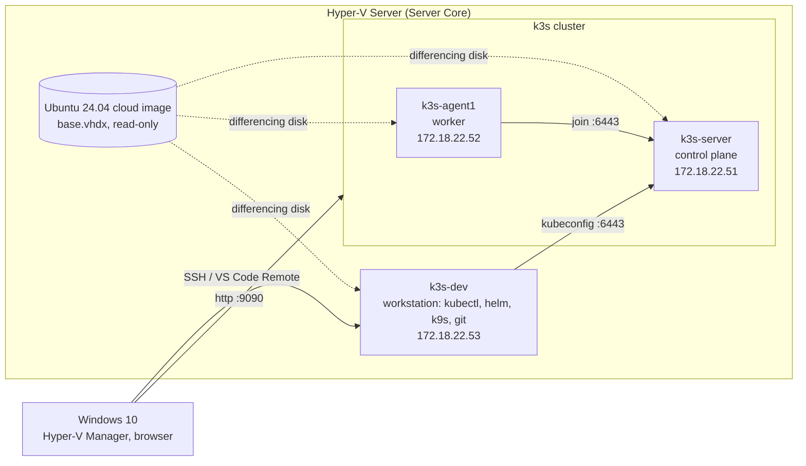

# k3s-homelab

A small, fully reproducible Kubernetes homelab built on **k3s** running on **Hyper-V Server**.
Virtual machines are created from the official Ubuntu Cloud image and configured with **cloud-init**,
so there is no manual OS installation: a new node is ready in about a minute.

The goal of this project is hands-on practice with Kubernetes and the DevOps toolchain,
from infrastructure automation to deploying and exposing real applications.

## Architecture



| Component | Role |
| --- | --- |
| Hyper-V Server | hypervisor, no GUI, managed remotely from Windows 10 |
| Ubuntu 24.04 cloud image | base disk converted from qcow2 to VHDX with `qemu-img` |
| Differencing disks | each VM stores only its changes on top of the shared base image |
| cloud-init (NoCloud) | hostname, static IP, user and packages from a small FAT32 `CIDATA` disk |
| k3s | lightweight Kubernetes: 1 control plane node, 1 worker |
| k3s-dev | dedicated workstation; the cluster is managed remotely, never from the nodes |

## Tech stack

- **Virtualization:** Hyper-V Server, PowerShell, Gen2 VMs with Secure Boot (Microsoft UEFI CA template)
- **Provisioning:** Ubuntu Cloud images, cloud-init, `qemu-img`
- **Kubernetes:** k3s, containerd, Traefik, ServiceLB, CoreDNS, local-path-provisioner
- **Tooling:** kubectl, Helm, k9s, Git

## Repository structure

```
k3s-homelab/
├── infra/hyperv/      # PowerShell scripts: base image, cluster nodes, dev VM, reset
├── apps/linkding/     # Kubernetes manifests for Linkding
└── README.md
```

## Reproducing the lab

### Prerequisites

- Hyper-V host with an External virtual switch
- Three free IP addresses outside the DHCP range
- PowerShell session on the Hyper-V host (local or `Enter-PSSession`)

### 1. Base image

Downloads `qemu-img` and the Ubuntu 24.04 cloud image, converts it to a dynamic VHDX,
resizes it to 20 GB and marks it read-only. Run once.

### 2. Cluster nodes and dev VM

For every node the script:

1. creates a differencing disk on top of the base image,
2. builds a 128 MB FAT32 seed disk labelled `CIDATA` with `meta-data`, `network-config` and `user-data`,
3. creates a Gen2 VM with static memory and Secure Boot set to the Microsoft UEFI CA template,
4. attaches the seed disk and starts the VM.

Edit the settings block at the top of each script (switch name, gateway, IPs) before running.
The user password is requested at runtime and is never stored in the repository.

```powershell
powershell -ExecutionPolicy Bypass -File .\infra\hyperv\k3s-lab.ps1
```

### 3. k3s

On the server node:

```bash
curl -sfL https://get.k3s.io | sh -
sudo cat /var/lib/rancher/k3s/server/node-token
```

On the worker node:

```bash
curl -sfL https://get.k3s.io | K3S_URL=https://<server-ip>:6443 K3S_TOKEN=<token> sh -
```

### 4. Remote access from k3s-dev

```bash
mkdir -p ~/.kube
ssh <user>@<server-ip> sudo cat /etc/rancher/k3s/k3s.yaml > ~/.kube/config
sed -i 's/127.0.0.1/<server-ip>/' ~/.kube/config
chmod 600 ~/.kube/config
kubectl get nodes -o wide
```

## Applications

### Linkding

Self-hosted bookmark manager ([sissbruecker/linkding](https://github.com/sissbruecker/linkding)).

| Resource | Purpose |
| --- | --- |
| Deployment | keeps one replica running; `Recreate` strategy because the volume is ReadWriteOnce; readiness probe on `/health` |
| PersistentVolumeClaim | 1 Gi on `local-path`, so bookmarks survive pod restarts |
| Service (LoadBalancer) | exposed on port 9090 through k3s ServiceLB |
| Secret | admin credentials, created imperatively and never committed |

```bash
kubectl create secret generic linkding-superuser \
  --from-literal=username=<user> \
  --from-literal=password='<password>'
kubectl apply -f apps/linkding/
```

## Lessons learned

- A kubeconfig copied from the server points to `127.0.0.1`; on another machine `kubectl` then connects to itself.
- Kubernetes Secrets are base64 encoded, not encrypted. Protection comes from RBAC, etcd encryption
  and tools such as Sealed Secrets, SOPS or External Secrets.
- A ReadWriteOnce volume and a `RollingUpdate` strategy do not mix: the new pod waits for a volume
  still held by the old one.
- cloud-init files must be UTF-8 without BOM and use LF line endings.

## Roadmap

- [x] Hyper-V VMs from cloud images with cloud-init
- [x] k3s cluster: control plane and worker
- [x] Remote management from a dedicated workstation
- [x] Stateful application with PVC, Secret and LoadBalancer
- [ ] Ingress with Traefik and hostnames
- [ ] Kustomize and namespaces per application
- [ ] Monitoring with Prometheus and Grafana via Helm
- [ ] GitOps with Flux or Argo CD
- [ ] CI pipeline with Jenkins: build, push, deploy
